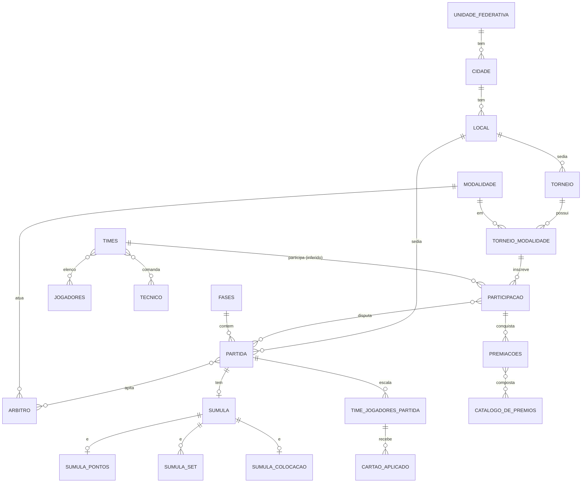

# PlayOff — Relatório Geral do Projeto

> Documento consolidado a partir de `PlayOff.pdf` (modelagem: DER, modelo relacional, diagrama de classes, casos de uso, atividades, estados e sequência) e `Requisitos Funcionais_PlayOff.pdf` (RF01–RF07).
>
> **Convenção de leitura:** as seções 2, 3 (mercado) e 8–13 (tecnologias, arquitetura, API, frontend etc.) contêm **propostas técnicas e de negócio** derivadas dos documentos, não decisões já tomadas pela equipe. Onde algo é inferência ou há divergência entre os diagramas, está sinalizado com **[Proposta]** ou **[Atenção]**.

**Equipe (discentes):** Amanda Lordello, Davi Braz, Saulo Sousa, Thales Sena, Victor Lopes
**Docente:** Claudia Simões

---

## Sumário

1. [Visão geral](#1-visão-geral)
2. [Lógica de mercado](#2-lógica-de-mercado)
3. [Público-alvo, personas e proposta de valor](#3-público-alvo-personas-e-proposta-de-valor)
4. [Requisitos](#4-requisitos)
5. [Atores e casos de uso](#5-atores-e-casos-de-uso)
6. [Domínio e regras de negócio](#6-domínio-e-regras-de-negócio)
7. [Modelagem de dados](#7-modelagem-de-dados)
8. [Stack tecnológica proposta](#8-stack-tecnológica-proposta)
9. [Arquitetura](#9-arquitetura)
10. [Backend e API](#10-backend-e-api)
11. [Frontend](#11-frontend)
12. [Motores de competição e algoritmos](#12-motores-de-competição-e-algoritmos)
13. [Segurança, qualidade e infraestrutura](#13-segurança-qualidade-e-infraestrutura)
14. [Protótipo (escopo do MVP)](#14-protótipo-escopo-do-mvp)
15. [Roadmap](#15-roadmap)
16. [Inconsistências e lacunas nos documentos](#16-inconsistências-e-lacunas-nos-documentos)
17. [Glossário](#17-glossário)

---

## 1. Visão geral

**PlayOff** é uma plataforma web para **criar, administrar e acompanhar campeonatos esportivos**. Cobre o ciclo completo de um torneio, "da concepção até o fim" (RF01):

1. Criação do torneio (nome, período, local, visibilidade pública/privada).
2. Definição de modalidades (esporte, categoria M/F, submodalidade como dupla ou quarteto).
3. Escolha de formato de disputa (eliminação simples, fase de grupos, mata-mata, entre outros) e fases.
4. Cadastro de times, jogadores, técnicos e árbitros.
5. Geração de chaveamento, grupos, sorteios, jogos e calendário.
6. Registro de súmulas (pontos, sets ou colocação/tempo), cartões e resultados.
7. Premiação.
8. Acompanhamento público: chaveamento visual, partidas, times, jogadores, favoritos.

Dois perfis centrais: o **Organizador**, que administra, e o **Usuário/Espectador**, que acompanha.

**Diferenciais declarados nos requisitos:**
- Suporte a **diferentes modalidades com tipos de súmula distintos** (futebol e afins, vôlei e afins, natação e afins).
- **Otimização logística e balanceamento dinâmico** de campeonatos, reduzindo conflitos de horário (RF04).
- **Painel visual e interativo** (RF05).
- **Identidade visual personalizável por organização** (RF06), ou seja, um modelo white-label.

---

## 2. Lógica de mercado

> **[Proposta]** Os documentos não trazem estudo de mercado. Esta seção é uma análise estruturada para fundamentar o produto.

### 2.1 Problema
Campeonatos amadores, escolares, universitários, de condomínio, de empresas e de ligas locais costumam ser geridos com **planilhas, grupos de WhatsApp e papel**. Dores recorrentes:

| Dor | Consequência |
|---|---|
| Montar chaveamento e tabela à mão | Erros, demora, disputas por "sorteio duvidoso" |
| Conflito de horário/quadra/árbitro | Jogos atrasados, WO, desgaste do organizador |
| Resultados espalhados | Participantes e torcida sem fonte única de informação |
| Súmula em papel | Perda de dados, dificuldade de estatística |
| Falta de identidade/profissionalismo | Dificulta patrocínio e captação de times |
| Esportes diferentes, regras diferentes | Ferramentas genéricas não cobrem pontos, sets e colocação |

### 2.2 Solução
Uma plataforma que automatiza chaveamento, calendário e súmula, com um painel público que dá transparência e engajamento, e com a marca de cada organizador.

### 2.3 Segmentos de mercado
1. **Escolar e universitário** (atléticas, jogos internos, interclasse).
2. **Ligas e federações amadoras** (futebol society, vôlei, futsal, basquete 3x3).
3. **Empresas e condomínios** (torneios corporativos e de lazer).
4. **Arenas e quadras privadas** (que organizam campeonatos como produto).
5. **Organizadores independentes e eventos** (copas de bairro, torneios beneficentes).

### 2.4 Concorrência (categorias, não exaustivo)
- **Planilhas + WhatsApp:** concorrente real número um (custo zero, alto atrito).
- **Plataformas de torneio internacionais** (ferramentas de bracket/liga): fortes em chaveamento, geralmente fracas em localização (pt-BR), súmulas multimodalidade e identidade por organização.
- **Apps de gestão esportiva de times:** foco em elenco e agenda de um time, não em torneio multi-time.

**Posicionamento sugerido:** o PlayOff é a plataforma **brasileira, multimodalidade e white-label** para organizadores, com acompanhamento público em tempo real.

### 2.5 Modelo de negócio (opções)
| Modelo | Descrição |
|---|---|
| **Freemium** | Torneios simples e públicos grátis; recursos avançados (otimização logística, marca própria, torneios privados, exportação) pagos |
| **Assinatura para organizações** | Planos por número de torneios ativos/times (ligas, arenas, escolas) |
| **Taxa por torneio** | Cobrança única por campeonato |
| **Inscrição integrada** | Comissão sobre taxas de inscrição dos times (exige gateway de pagamento, fase futura) |
| **Patrocínio no painel** | Espaços para patrocinadores no painel público (a premiação e a identidade visual já abrem esse caminho) |

### 2.6 Métricas de sucesso
Torneios criados por mês, times por torneio, taxa de torneios concluídos, partidas com súmula registrada, usuários espectadores recorrentes, torneios favoritados, retenção de organizadores (reutilizam a plataforma em um segundo torneio).

### 2.7 Riscos de mercado
- Baixo custo de troca para a planilha (precisa ser muito mais simples que ela).
- Sazonalidade esportiva.
- Dependência de poucos organizadores "heavy users".
- Escopo largo demais (muitas modalidades) antes de validar uma só.

---

## 3. Público-alvo, personas e proposta de valor

> **[Proposta]**

**Persona 1: Organizador (ex.: coordenador de liga universitária).** Quer montar o campeonato em minutos, evitar conflito de agenda, ter autoridade e transparência. Usa mais o computador, e também o celular na quadra para lançar súmula.

**Persona 2: Espectador/Jogador/Torcedor.** Quer saber "quando é meu jogo, contra quem e como está a tabela". Acessa pelo celular, sem cadastro pesado, favoritando torneios.

**Persona 3: Árbitro/mesário.** Registra súmula e cartões durante a partida.
*(Nos documentos o árbitro é entidade de dados, não ator com login. Pode virar perfil futuro.)*

**Proposta de valor:**
- Para o organizador: menos trabalho manual, menos erro, mais profissionalismo.
- Para o público: informação única, atualizada e visual.
- Para a organização: marca própria sobre a plataforma.

---

## 4. Requisitos

### 4.1 Requisitos funcionais (fonte oficial)

| ID | Descrição |
|---|---|
| **RF01** | Criação de torneios personalizáveis, da concepção até o fim, com diferentes formatos de disputa (eliminação simples, fase de grupos, mata-mata, entre outros). |
| **RF02** | Cadastro dos times ou equipes participantes. |
| **RF03** | Geração automática ou manual de chaveamentos, grupos, sorteios, tabelas de resultados e súmulas das partidas. |
| **RF04** | Algoritmos inteligentes de otimização logística e balanceamento dinâmico de campeonatos, reduzindo conflitos de horário. |
| **RF05** | Painel visual e interativo para acompanhamento e administração das chaves, resultados e calendário de jogos. |
| **RF06** | Personalização da identidade visual e da interface para cada organização. |
| **RF07** | Login de usuários. |

### 4.2 Requisitos derivados dos diagramas

Os casos de uso, classes e diagramas de atividade/sequência acrescentam funcionalidades que os RFs não listam explicitamente:

- Favoritar torneio (usuário).
- Torneios **públicos e privados**, com validação de credencial para os privados.
- Cadastro de jogadores, técnicos, árbitros, telefones.
- Cadastro e gestão de prêmios (catálogo de prêmios + premiação).
- Advertências/cartões por jogador por partida.
- Cabeças de chave (seeds).
- Excluir/editar torneio.
- Ciclo de vida do torneio (estados) e da partida (status).

### 4.3 Requisitos não funcionais **[Proposta]**

| Categoria | Meta sugerida |
|---|---|
| Desempenho | Páginas públicas < 2 s em 4G; geração de chaveamento de até 128 times < 3 s |
| Disponibilidade | 99,5% (MVP), com cache de páginas públicas |
| Responsividade | Mobile-first (súmula e consulta na quadra) |
| Segurança | Senhas com hash forte, HTTPS, RBAC, LGPD (CPF, RG, telefone, data de nascimento são dados pessoais) |
| Usabilidade | Criar um torneio simples em < 5 min |
| Acessibilidade | WCAG 2.1 AA (contraste, teclado, leitores de tela) |
| Manutenibilidade | Código tipado, testes nos motores de chaveamento |
| Internacionalização | pt-BR no início, estrutura pronta para i18n |
| Observabilidade | Logs estruturados, métricas de erro e desempenho |

---

## 5. Atores e casos de uso

### 5.1 Atores
- **Usuário** (espectador): consulta.
- **Organizador:** generalização do usuário (herda todos os seus casos de uso) e administra.

No diagrama de classes: `Usuario` → `Espectador` → `Organizador`, por herança. O `Usuario` tem `idUsuario, nome, cpf, rg, dataNascimento, idade, e-mail, senha`.

### 5.2 Casos de uso

**Usuário**
- Fazer login
- Acessar torneio
- Favoritar torneio
- Visualizar chaveamento
- Visualizar partida
- Visualizar time
- Visualizar jogador

**Organizador** (além dos acima)
- Criar torneio (*include* → Definir modalidade)
- Editar torneio
- Excluir torneio
- Adicionar times
- Adicionar jogadores
- Cadastrar técnico
- Cadastrar árbitro
- Selecionar as fases
- Adicionar cabeças de chave
- Gerar jogos
- Registrar súmula
- Cadastrar prêmio

### 5.3 Fluxo: Acessar torneio (atividade + estados + sequência)

1. Usuário abre o sistema; o sistema lista os torneios disponíveis (com filtros).
2. Usuário seleciona um torneio; o sistema carrega os dados.
3. **Se o torneio é privado**, o sistema verifica permissão. Credencial correta → *Acesso concedido*; incorreta → *Acesso negado* (o usuário pode tentar de novo ou desistir).
4. **Se o torneio não existe ou está inativo** → *Torneio não encontrado* (nova busca).
5. Se há partidas registradas → exibe chaveamento e resultados; senão → exibe modalidades e times inscritos.
6. Usuário navega entre times, jogadores e partidas e decide se favorita.
7. Se o usuário é o **organizador do torneio**, o servidor habilita as opções de gestão.

**Estados da navegação:** Buscando torneio → Torneio localizado → (público) Acesso concedido | (privado) Verificando permissão → Acesso concedido / Acesso negado. Exceção: Torneio não encontrado.

### 5.4 Fluxo: Criar torneio (atividade + sequência)

1. Organizador acessa "Criar novo torneio".
2. Sessão e perfil são verificados (token → busca de usuário). Sem permissão → acesso negado → redireciona ao login.
3. Preenche dados (nome, período) e cadastra uma ou mais modalidades (laço "adicionar outra modalidade?").
4. Validação no cliente (campos obrigatórios) e no servidor (regras de negócio).
5. Dados inválidos → mensagem de erro e volta ao formulário.
6. Verifica duplicidade (`buscarTorneioPorNome(nome, idOrganizador)`); duplicado → erro.
7. Persiste: torneio → modalidades (laço) → fases/premiação (opcional).
8. Falha na gravação → **rollback** (`desfazerGravacao`) e erro ao usuário.
9. Sucesso → confirmação. Em paralelo (**fork/join**): *gerar chaveamento inicial das modalidades* e *publicar torneio no catálogo público*.
10. Define status como **"Agendado"**.

### 5.5 Máquina de estados do Torneio

```
Em criação ──publicar()──▶ Publicado (inscrições abertas) ──encerrar inscrições()/prazo──▶
Chaveamento definido ──iniciar()──▶ Em andamento ──concluir()/última partida──▶ Finalizado
                    (editar() permitido em Publicado, antes do fechamento)
Qualquer estado ativo ──cancelar()──▶ Cancelado
```

Na classe `Torneio`, os métodos são `iniciar()`, `encerrar()` e `adicionarModalidade(m)`, e o atributo `status: StatusTorneio`.

> **[Atenção]** O diagrama de atividade termina em "Agendado" e o de estados usa "Em criação / Publicado / Chaveamento definido…". É preciso unificar o vocabulário (ver seção 16).

---

## 6. Domínio e regras de negócio

### 6.1 Entidades principais (visão conceitual)

- **Torneio**: evento com período, local e visibilidade. Contém várias **Modalidades** (relação N:N via `TORNEIO_MODALIDADE`).
- **Modalidade**: esporte + categoria (M/F) + submodalidade (ex.: dupla, quarteto).
- **Participação**: a inscrição de um **Time** em uma modalidade de um torneio. É a entidade-chave que conecta times, partidas e premiações.
- **Time**: nome, escudo; tem **Jogadores** (N:N) e **Técnico** (N:N na modelagem relacional).
- **Jogador**: nome, apelido, CPF, nascimento, número da camisa, sexo.
- **Técnico**, **Árbitro**: nome, CPF (árbitro), nascimento (técnico). O árbitro atua em uma modalidade.
- **Partida**: data, hora, status, fase, local; realizada entre participações; tem árbitros (N:N), cartões e **Súmula**.
- **Fases**: etapa da competição (eliminatórias, mata-mata, fase de grupos).
- **Local → Cidade → Unidade Federativa**: endereço com CEP, logradouro, bairro, número.
- **Telefone**: pertence a jogador, técnico **ou** árbitro (exclusivo).
- **Advertência/Cartão**: cor; associada ao jogador do time em uma partida.
- **Súmula**: registro oficial da partida; **generalização disjunta** em três especializações.
- **Premiação / Catálogo de Prêmios**: prêmios cadastrados e concedidos (coletivos ou individuais, com valor).

### 6.2 Súmulas por tipo de esporte

| Tipo | Esportes (ex.) | Campos |
|---|---|---|
| **Súmula de Pontos** | Futebol, futsal, basquete, handebol | Pontuação equipe 1, equipe 2 |
| **Súmula de Set** | Vôlei, tênis, beach tennis, tênis de mesa | Nº do set, pontuação equipe 1, equipe 2 (uma linha por set) |
| **Súmula de Colocação** | Natação, atletismo, corrida | Tempo, colocação |

A classe abstrata `Súmula` tem `idSumula, dataRegistro, observacoes` e o método abstrato `calcularResultado()`. As subclasses o implementam (polimorfismo), e o resultado alimenta o avanço no chaveamento.

> **[Atenção]** O diagrama de classes só tem `SumulaPontos` e `SumulaColocacao`; o ER e o relacional também têm `SumulaSet`. O MVP deve implementar as três.

### 6.3 Regras de negócio inferidas

- **RN01** Um torneio tem ao menos uma modalidade.
- **RN02** Nome do torneio é único por organizador.
- **RN03** Torneio privado exige credencial para acesso; público aparece no catálogo.
- **RN04** Só o organizador do torneio acessa as opções de gestão.
- **RN05** Um time se inscreve em uma modalidade de um torneio (Participação); pode estar em várias.
- **RN06** Um jogador pode pertencer a vários times (N:N), com restrição de elegibilidade por torneio **[Proposta]**.
- **RN07** Uma partida pertence a uma fase e a um local, e tem um ou mais árbitros.
- **RN08** Cartões vinculam-se a jogador, time e partida.
- **RN09** A súmula depende do tipo de esporte da modalidade (pontos, set ou colocação).
- **RN10** Não pode haver, no mesmo horário, a mesma quadra/local, o mesmo árbitro ou o mesmo time em duas partidas (base do RF04).
- **RN11** A transição de estados do torneio segue a máquina da seção 5.5.
- **RN12** Falha na gravação da criação do torneio desfaz toda a operação (transação).
- **RN13 [Proposta]** Edição de torneio só antes do fechamento das inscrições.
- **RN14 [Proposta]** Registrar súmula só em partida "agendada"/"em andamento"; ao encerrar, o resultado é imutável (exceto correção auditada).

### 6.4 Ciclo de vida da partida **[Proposta]**
`Agendada → Em andamento → Encerrada` e, alternativamente, `Adiada | Cancelada | WO`. O ER indica `Status` como atributo derivado (tracejado), então pode ser calculado, mas armazená-lo simplifica as consultas.

---

## 7. Modelagem de dados

### 7.1 Modelo relacional (fiel ao PDF)

**Localização**
- `UNIDADE_FEDERATIVA (PK id_uf, nome)`
- `CIDADE (PK id_cidade, FK id_uf, nome)`
- `LOCAL (PK id_local, FK id_cidade, cep, bairro, logradouro, numero_logradouro)`

**Competição**
- `MODALIDADE (PK id_modalidade, esporte, categoria_mf, submodalidade)`
- `TORNEIO (PK id_torneio, nome_torneio, data_inicio, data_fim, status[privado|publico], FK id_local)`
- `TORNEIO_MODALIDADE (PK id_torneio_modalidade, FK id_torneio, FK id_modalidade)`
- `PARTICIPACAO (PK id_participacao, FK id_torneio_modalidade)`
- `PARTICIPACAO_PARTIDA (PK, FK id_participacao, FK id_partida)`
- `FASES (PK id_fases, descricao)`
- `PARTIDA (PK id_partida, hora_partida, data_partida, status, FK id_fases, FK id_local)`

**Pessoas**
- `JOGADORES (PK id_jogadores, nome_jogador, apelido, cpf, data_nascimento)`
- `TIMES (PK id_times, nome_time, escudo)`
- `TIMES_JOGADORES (PK, FK id_jogadores, FK id_times)`
- `TECNICO (PK id_tecnico, nome_tecnico, data_nascimento)`
- `TECNICO_TIMES (PK, FK id_tecnico, FK id_times)`
- `ARBITRO (PK id_arbitro, nome_arbitro, cpf, FK id_modalidade)`
- `PARTIDA_ARBITRO (PK, FK id_partida, FK id_arbitro)`
- `TELEFONE (PK id_telefone, FK id_jogadores?, FK id_tecnico?, FK id_arbitro?, numero)`

**Disciplina**
- `TIME_JOGADORES_PARTIDA (PK, FK id_time_jogadores, FK id_partida)`
- `ADVERTENCIA_CARTAO (PK id_cartao, cor)`
- `TIME_JOGADORES_PARTIDA_CARTAO (PK, FK time_jogadores_partida, FK id_cartao)`

**Súmula** (generalização por tabela por subclasse)
- `SUMULA (PK id_sumula, FK id_partida)`
- `SUMULA_PONTOS (PK/FK id_sumula, pontuacao_equipe_1, pontuacao_equipe_2)`
- `SUMULA_SET (PK/FK id_sumula, set, pontuacao_equipe_1, pontuacao_equipe_2)`
- `SUMULA_COLOCACAO (PK/FK id_sumula, tempo, colocacao)`

**Premiação**
- `CATALOGO_DE_PREMIOS (PK id_premio, nome_premio)`
- `PREMIACOES (PK id_premiacao, valor, tipo_de_premio[coletivo|individual], FK id_participacao)`
- `PREMIACAO_PREMIO (PK, FK id_premiacao, FK id_premio)`

### 7.2 Diagrama (visão simplificada)



### 7.3 Observações e melhorias recomendadas **[Proposta]**

O relacional entregue é a base acadêmica. Para o sistema real, recomenda-se:

1. **Ligar `PARTICIPACAO` a `TIMES`** (`id_times`) e a `TORNEIO_MODALIDADE`. Pelo PDF, `PARTICIPACAO` só aponta para `TORNEIO_MODALIDADE`; no ER ela se liga ao time (relação "TEM"), mas o relacional não traz essa FK.
2. **Entidade `USUARIO`** (login, RF07), ausente do modelo relacional mas presente no diagrama de classes (`id, nome, cpf, rg, email, senha_hash, papel`). Adicionar também `ORGANIZACAO`/`TENANT` (RF06) e `TORNEIO.id_organizador`.
3. **`FAVORITO (id_usuario, id_torneio)`** para o caso de uso "Favoritar torneio".
4. **Credencial de torneio privado**: campo `codigo_acesso` (hash) ou convites.
5. **Súmula de set**: PK composta `(id_sumula, set)`.
6. **Telefone**: `CHECK` garantindo que exatamente uma das três FKs seja preenchida (ou tabela polimórfica).
7. **Partida ↔ Participação**: normalmente 2 participações por partida (mandante/visitante). Considerar `mandante`/`visitante` explícitos ou um campo `lado` em `PARTICIPACAO_PARTIDA`.
8. **Chaveamento/Grupos**: faltam estruturas como `GRUPO`, `RODADA`, `posicao_na_chave`, `partida_origem_vencedor/perdedor` para o avanço automático.
9. **Status** de partida/torneio como `ENUM` ou tabela de domínio.
10. **Auditoria**: `created_at`, `updated_at`, `created_by`; correção de súmula com histórico.
11. **Soft delete** em torneios (excluir ≠ apagar histórico).
12. **Índices**: `(data_partida, id_local)`, `(id_arbitro, data_partida)`, `(id_torneio)`, CPF único com cuidado LGPD.
13. **Cartões**: tipo (amarelo, vermelho), minuto e motivo (a classe `Advertencia` já prevê `tipo, minuto, motivo, cor`; o relacional só tem `cor`).

---

## 8. Stack tecnológica proposta

> **[Proposta]** Os documentos não definem tecnologias. A stack abaixo prioriza velocidade de entrega, tipagem ponta a ponta e aderência ao modelo relacional do projeto.

| Camada | Tecnologia sugerida | Por quê |
|---|---|---|
| Linguagem | **TypeScript** (front e back) | Tipagem compartilhada; menos bugs nos motores |
| Frontend | **React + Vite** (ou **Next.js** se houver SEO) | Ecossistema, componentes ricos para chaveamento |
| Estilo | **Tailwind CSS** + **shadcn/ui** | Tokens de tema, base para white-label (RF06) |
| Estado/dados no cliente | **TanStack Query** + **Zustand** | Cache de API e estado local simples |
| Formulários/validação | **React Hook Form + Zod** | Schemas reaproveitados no servidor |
| Visualização de chaves | **SVG customizado** (ou biblioteca de bracket) | Controle total de layout/interação |
| Backend | **Node.js + NestJS** (ou Fastify) | Estrutura modular, DI, bom para domínio rico |
| ORM | **Prisma** ou **Drizzle** | Migrações e tipos a partir do schema |
| Banco | **PostgreSQL** | Relacional (o modelo é fortemente relacional), `CHECK`, `ENUM`, índices parciais, `EXCLUDE` para conflitos de horário |
| Auth | **JWT (access + refresh)** ou Supabase Auth / Auth.js | RF07 |
| Cache/filas | **Redis** + **BullMQ** | Geração de jogos/otimização assíncrona, cache público |
| Tempo real | **WebSocket/SSE** (ou Supabase Realtime) | Placar ao vivo, súmula |
| Armazenamento | **S3 compatível** (ou Supabase Storage) | Escudos, logos |
| Testes | **Vitest/Jest**, **Playwright** (E2E), **Testcontainers** | Cobertura dos algoritmos |
| CI/CD | **GitHub Actions** | Lint, testes, deploy |
| Hospedagem | Front: Vercel/Netlify · Back: Fly.io/Render/Railway · DB: Supabase/Neon | Baixo custo no MVP |
| Observabilidade | **Sentry** + logs estruturados (pino) + OpenTelemetry | Erros e desempenho |
| Documentação da API | **OpenAPI/Swagger** | Contrato e geração de clientes |

**Alternativa enxuta para o MVP/protótipo:** React + Supabase (Postgres, Auth, Realtime, Storage, RLS), sem backend próprio inicialmente, com os motores de chaveamento rodando no cliente ou em Edge Functions.

---

## 9. Arquitetura

### 9.1 Visão em camadas

O diagrama de sequência já define três participantes: **Interface PlayOff → Servidor PlayOff → Banco de Dados**. A arquitetura proposta formaliza isso.

```
┌────────────────────────────────────────────────────────────┐
│  Cliente (SPA/PWA React)                                   │
│  Catálogo · Torneio · Chaveamento · Súmula · Admin · Tema  │
└───────────────▲──────────────────────┬─────────────────────┘
                │ HTTPS/JSON (REST)    │ WebSocket/SSE (ao vivo)
┌───────────────┴──────────────────────▼─────────────────────┐
│  API / Servidor PlayOff (monólito modular)                 │
│  Auth · Torneios · Cadastros · Competição · Agenda ·       │
│  Súmula · Premiação · Organização/Tema · Notificações      │
│  ── Motores de domínio: chaveamento · grupos · agenda ──   │
└───────▲───────────────────────▲───────────────────▲────────┘
        │ SQL                   │ jobs              │ arquivos
  ┌─────┴─────┐           ┌─────┴─────┐       ┌─────┴─────┐
  │ PostgreSQL│           │   Redis   │       │  Storage  │
  └───────────┘           └───────────┘       └───────────┘
```

### 9.2 Estilo arquitetural
**Monólito modular** com fronteiras claras entre módulos (preparado para extrair serviços se necessário). Evita a complexidade de microsserviços para um time pequeno.

### 9.3 Módulos de backend

| Módulo | Responsabilidade | Casos de uso cobertos |
|---|---|---|
| `auth` | Cadastro, login, sessão, papéis | Fazer login |
| `organizacoes` | Tenant, tema, identidade visual | RF06 |
| `torneios` | CRUD, estados, visibilidade, favoritos | Criar/editar/excluir/acessar/favoritar |
| `modalidades` | Catálogo de esportes, categorias, submodalidades | Definir modalidade |
| `cadastros` | Times, jogadores, técnicos, árbitros, telefones, locais | RF02, adicionar jogadores/técnicos/árbitros |
| `competicao` | Fases, grupos, seeds, chaveamento, geração de jogos | RF01, RF03 |
| `agenda` | Calendário, alocação de horário/local/árbitro, otimização | RF04 |
| `sumulas` | Registro por tipo, cartões, cálculo de resultado | Registrar súmula |
| `premiacoes` | Catálogo e concessão | Cadastrar prêmio |
| `publico` | Consultas somente leitura, cache | Visualizar chave/partida/time/jogador |

### 9.4 Padrões de projeto sugeridos
- **Strategy**: formato de disputa (`EliminacaoSimples`, `FaseDeGrupos`, `PontosCorridos`, `DuplaEliminacao`) e tipo de súmula (`calcularResultado()` polimórfico, como no diagrama de classes).
- **Factory**: cria a súmula certa a partir da modalidade.
- **State**: ciclo de vida do torneio e da partida.
- **Repository**: isola o acesso a dados.
- **Observer/Eventos de domínio**: ao encerrar uma partida, avança o chaveamento, atualiza classificação e notifica favoritos.
- **Unit of Work/Transação**: criação de torneio atômica (RN12).

### 9.5 Multi-tenancy (RF06)
Cada **Organização** é um tenant: `organizacao_id` nas entidades de negócio; tema (cores, logo, fonte, domínio/slug) carregado por organização. Isolamento por Row Level Security (Postgres) ou filtro obrigatório na camada de repositório.

### 9.6 Fluxos principais (resumo das sequências)
- **Criar torneio:** UI valida → `POST /torneios` → servidor valida sessão, perfil e regras → checa duplicidade → transação (torneio, modalidades, fases, premiação) → fork: gerar chaveamento inicial + publicar no catálogo → status inicial → resposta 201.
- **Acessar torneio:** `GET /torneios` (lista com filtros) → `GET /torneios/:id` (com token se privado) → servidor checa existência/ativo → checa permissão → agrega modalidades, fases, times, partidas → se organizador, inclui permissões de gestão.

---

## 10. Backend e API

### 10.1 Convenções **[Proposta]**
REST sobre HTTPS, JSON, prefixo `/api/v1`, autenticação `Authorization: Bearer <jwt>`, paginação por cursor/`page`+`limit`, erros no formato `{ code, message, details }`, contrato em OpenAPI. Códigos: 200/201/204, 400 (validação), 401 (não autenticado), 403 (sem permissão/privado), 404, 409 (duplicado/conflito de agenda), 422.

### 10.2 Endpoints

**Autenticação**
| Método | Rota | Descrição |
|---|---|---|
| POST | `/auth/registro` | Cria usuário |
| POST | `/auth/login` | Login, devolve tokens |
| POST | `/auth/refresh` | Renova sessão |
| POST | `/auth/logout` | Encerra sessão |
| GET | `/me` | Dados e perfil do usuário |

**Torneios**
| Método | Rota | Descrição |
|---|---|---|
| GET | `/torneios` | Lista pública (filtros: nome, esporte, cidade, status, período) |
| POST | `/torneios` | Cria (organizador) |
| GET | `/torneios/:id` | Detalhe (valida privacidade) |
| PATCH | `/torneios/:id` | Edita |
| DELETE | `/torneios/:id` | Exclui (soft) |
| POST | `/torneios/:id/acesso` | Valida credencial de torneio privado |
| POST | `/torneios/:id/transicoes` | `{ evento: "publicar" \| "encerrar_inscricoes" \| "iniciar" \| "concluir" \| "cancelar" }` |
| PUT/DELETE | `/torneios/:id/favorito` | Favorita/desfavorita |
| GET | `/me/favoritos` | Torneios favoritos |

**Modalidades e fases**
| Método | Rota | Descrição |
|---|---|---|
| GET | `/modalidades` | Catálogo |
| POST | `/torneios/:id/modalidades` | Vincula modalidade |
| DELETE | `/torneios/:id/modalidades/:mid` | Remove |
| GET/POST | `/torneios/:id/fases` | Lista / define fases e formato |

**Cadastros**
| Método | Rota |
|---|---|
| CRUD | `/times`, `/jogadores`, `/tecnicos`, `/arbitros`, `/locais` |
| POST/DELETE | `/times/:id/jogadores/:jid`, `/times/:id/tecnico/:tid` |
| GET/POST | `/cidades`, `/ufs` (apoio a endereço, ou integração ViaCEP) |

**Participação e competição**
| Método | Rota | Descrição |
|---|---|---|
| POST | `/torneios/:id/modalidades/:mid/participacoes` | Inscreve time |
| DELETE | `/participacoes/:id` | Remove inscrição |
| PUT | `/participacoes/:id/seed` | Define cabeça de chave |
| POST | `/torneios/:id/modalidades/:mid/sorteio` | Sorteia grupos/chave |
| POST | `/torneios/:id/modalidades/:mid/gerar-jogos` | Gera partidas (RF03) |
| GET | `/torneios/:id/modalidades/:mid/chaveamento` | Estrutura da chave (RF05) |
| GET | `/torneios/:id/modalidades/:mid/classificacao` | Tabela/classificação |

**Agenda (RF04)**
| Método | Rota | Descrição |
|---|---|---|
| POST | `/torneios/:id/agenda/otimizar` | Executa otimização (assíncrona) |
| GET | `/torneios/:id/agenda/conflitos` | Lista conflitos |
| GET | `/torneios/:id/calendario` | Calendário de jogos |
| PATCH | `/partidas/:id/agendamento` | Reagenda manualmente (valida conflitos) |

**Partidas e súmula**
| Método | Rota | Descrição |
|---|---|---|
| GET | `/partidas/:id` | Detalhe |
| POST | `/partidas/:id/arbitros` | Designa árbitros |
| POST | `/partidas/:id/sumula` | Registra súmula (tipo pelo esporte) |
| PUT | `/partidas/:id/sumula` | Corrige (auditado) |
| POST | `/partidas/:id/cartoes` | Registra advertência/cartão |
| POST | `/partidas/:id/encerrar` | Encerra e propaga resultado na chave |

**Premiação**
| Método | Rota |
|---|---|
| CRUD | `/catalogo-premios` |
| POST | `/participacoes/:id/premiacoes` |
| GET | `/torneios/:id/premiacoes` |

**Organização e tema (RF06)**
| Método | Rota |
|---|---|
| GET/PUT | `/organizacoes/:id/tema` (cores, logo, fonte, banner) |
| POST | `/organizacoes/:id/logo` (upload) |

**Tempo real**
`WS /ao-vivo/torneios/:id`: eventos `partida.atualizada`, `placar`, `chave.atualizada`.

### 10.3 Exemplo de contrato

`POST /api/v1/torneios`
```json
{
  "nome": "Copa Interclasse 2026",
  "dataInicio": "2026-11-10",
  "dataFim": "2026-11-30",
  "visibilidade": "publico",
  "localId": 12,
  "modalidades": [
    { "esporte": "Futsal", "categoria": "M", "submodalidade": null, "formato": "FASE_DE_GRUPOS_MATA_MATA" },
    { "esporte": "Vôlei", "categoria": "F", "submodalidade": "quarteto", "formato": "ELIMINACAO_SIMPLES" }
  ],
  "fases": ["Grupos", "Quartas", "Semifinal", "Final"],
  "premiacoes": [{ "tipo": "coletivo", "premioId": 1, "valor": 500 }]
}
```
Resposta `201`: `{ "id": 87, "status": "AGENDADO", "chaveamentoGerado": true }`

### 10.4 Autorização (RBAC) **[Proposta]**

| Recurso | Anônimo | Usuário | Organizador (dono) | Admin da org |
|---|---|---|---|---|
| Listar torneios públicos | ✔ | ✔ | ✔ | ✔ |
| Ver torneio privado | ✖ | com credencial | ✔ | ✔ |
| Favoritar | ✖ | ✔ | ✔ | ✔ |
| Criar/editar/excluir torneio | ✖ | ✖ | ✔ (próprios) | ✔ |
| Cadastros, jogos, súmula, prêmios | ✖ | ✖ | ✔ | ✔ |
| Tema da organização | ✖ | ✖ | ✖ | ✔ |

Verificação de propriedade: `torneio.id_organizador == usuario.id` em toda rota de gestão (o passo "habilitarOpcoesDeGestao" do diagrama de sequência).

### 10.5 Jobs assíncronos
`gerar-jogos`, `otimizar-agenda`, `recalcular-classificacao`, `notificar-favoritos`, `gerar-pdf-sumula/tabela` (futuro).

---

## 11. Frontend

### 11.1 Mapa de telas

| # | Tela | Perfil | Origem (documento) |
|---|---|---|---|
| 1 | Login / Cadastro | Todos | RF07, caso de uso |
| 2 | Catálogo de torneios (busca, filtros, favoritos) | Todos | Acessar/Favoritar torneio |
| 3 | Acesso a torneio privado (credencial) | Usuário | Máquina de estados de acesso |
| 4 | Página do torneio (abas) | Todos | Visualizar chave/partida/time/jogador |
| 4a | Aba Chaveamento (visual) | Todos | RF05 |
| 4b | Aba Partidas / Calendário | Todos | RF05 |
| 4c | Aba Times e Jogadores | Todos | Visualizar time/jogador |
| 4d | Aba Classificação | Todos | RF03 |
| 4e | Aba Premiação | Todos | Premiação |
| 5 | Assistente "Criar torneio" (passos) | Organizador | Atividade/sequência criar torneio |
| 6 | Painel do organizador (meus torneios) | Organizador | Editar/excluir |
| 7 | Cadastro de times / jogadores / técnicos / árbitros / locais | Organizador | RF02 |
| 8 | Inscrição de times e cabeças de chave | Organizador | Adicionar times, cabeças de chave |
| 9 | Sorteio e geração de jogos | Organizador | RF03 |
| 10 | Agenda e otimização (conflitos) | Organizador | RF04 |
| 11 | Súmula (por tipo de esporte) + cartões | Organizador | Registrar súmula |
| 12 | Prêmios (catálogo, concessão) | Organizador | Cadastrar prêmio |
| 13 | Identidade visual da organização | Admin | RF06 |
| 14 | Perfil / Favoritos | Usuário | Favoritar |

### 11.2 Fluxo "Criar torneio" (wizard)
1. **Dados**: nome, período, local, visibilidade (público/privado + código).
2. **Modalidades**: adicionar (+ outra) esporte/categoria/submodalidade.
3. **Formato e fases**: por modalidade.
4. **Premiação** (opcional).
5. **Revisão** e validação → confirmação → redireciona ao torneio com status "Agendado".

Validação em tempo real (Zod) espelhando as regras do servidor; mensagens de erro inline (o diagrama de atividade prevê voltar ao formulário).

### 11.3 Componentes-chave
- **`<Bracket />`**: renderiza árvore de eliminação (SVG), rodadas em colunas, clique abre a partida, destaque do caminho de um time, zoom/pan no mobile.
- **`<GroupTable />`**: classificação por grupo (J, V, E, D, SG, Pts).
- **`<MatchCard />`**: times, placar, status, local, horário.
- **`<SumulaForm sport="pontos|set|colocacao" />`**: formulário polimórfico (placar simples, lista de sets, tabela de colocação/tempo) + cartões.
- **`<Calendar />`**: visão mensal/semanal/lista, filtro por time/quadra/árbitro, indicação de conflitos.
- **`<SeedSorter />`**: arrastar-e-soltar para cabeças de chave.
- **`<ThemeProvider />`**: aplica tokens da organização.

### 11.4 White-label (RF06)
Tokens CSS (`--brand-primary`, `--brand-secondary`, `--brand-bg`, `--radius`, fonte), logo, banner e slug/subdomínio (`liga-x.playoff.app`). Carregado antes da renderização para evitar "flash" de tema. Contraste mínimo validado automaticamente.

### 11.5 UX
Mobile-first (súmula na quadra), PWA instalável, modo escuro, estados vazios/erro/carregando em todas as telas, atualização em tempo real do placar, acessibilidade por teclado.

### 11.6 Estrutura de pastas sugerida
```
apps/
  web/            # React (rotas, features, componentes)
  api/            # NestJS (módulos da seção 9.3)
packages/
  domain/         # tipos, schemas Zod, motores (chaveamento/agenda) puros e testáveis
  ui/             # design system
docs/
```
Os motores de competição ficam em `packages/domain` como funções puras, reutilizáveis no protótipo (cliente) e no servidor.

---

## 12. Motores de competição e algoritmos

### 12.1 Formatos (RF01)
| Formato | Descrição | Observação |
|---|---|---|
| **Eliminação simples** | Perdeu, sai | Completar a chave com *byes* quando nº de times não é potência de 2 |
| **Dupla eliminação** | Chave de vencedores e perdedores | Futuro |
| **Fase de grupos** | Todos contra todos dentro do grupo | Critérios de desempate configuráveis |
| **Pontos corridos** | Turno e returno | Round-robin |
| **Grupos + mata-mata** | Classificados avançam | O formato mais comum |
| **Suíço** | Pareamento por desempenho | Futuro |

### 12.2 Geração de chave (eliminação simples)
1. Ordena participações por **seed** (cabeças de chave).
2. Calcula `P = 2^ceil(log2(N))`; `P − N` *byes* vão aos melhores seeds.
3. Posiciona seeds para que se encontrem só nas fases finais (1 vs P, 2 vs P−1, com a divisão em metades).
4. Gera partidas da 1ª rodada e "slots" vazios das seguintes, com `origem_vencedor` apontando para as partidas anteriores.
5. Ao encerrar uma partida, o vencedor ocupa o slot seguinte automaticamente.

### 12.3 Fase de grupos
- **Sorteio** respeitando potes (seeds espalhados entre grupos) e restrições (ex.: não repetir times da mesma entidade) **[Proposta]**.
- **Round-robin** pelo método do círculo (*circle method*): `N−1` rodadas (N par) com todos jogando por rodada.
- **Classificação**: pontos (V=3, E=1, D=0 configurável), saldo, gols pró, confronto direto, cartões, sorteio (ordem configurável por torneio).

### 12.4 Cálculo de resultado por súmula
- `SumulaPontos.calcularResultado()`: vence quem tem mais pontos; empate permitido na fase de grupos, decidido em mata-mata (prorrogação/pênaltis, campos adicionais **[Proposta]**).
- `SumulaSet.calcularResultado()`: vence quem ganha a maioria dos sets (ex.: melhor de 3/5); pontuação mínima e diferença de 2 pontos configuráveis.
- `SumulaColocacao.calcularResultado()`: ordena por tempo/colocação; define pódio e classifica os melhores para a fase seguinte.

### 12.5 Otimização logística e balanceamento (RF04)
Problema: alocar `n` partidas em `(data, horário, local)` e designar árbitros, **sem conflitos** e com **balanceamento**.

**Restrições duras**
- Um local/quadra não recebe duas partidas no mesmo intervalo.
- Um time não joga duas vezes no mesmo intervalo, e respeita descanso mínimo entre jogos.
- Um árbitro não apita duas partidas simultâneas e respeita sua modalidade.
- Um jogador que está em dois times (N:N) não pode ter jogos sobrepostos.
- Respeitar a janela do torneio (data início/fim) e a ordem das fases (a fase seguinte só depois da anterior).
- Respeitar indisponibilidades informadas **[Proposta]**.

**Restrições leves / objetivos**
- Minimizar jogos tardios e "buracos" na agenda.
- Distribuir carga entre árbitros e locais.
- Balancear descanso entre os times.
- Evitar repetir o mesmo horário ruim para o mesmo time.
- Minimizar deslocamentos (se houver múltiplos locais).

**Abordagem sugerida (progressiva)**
1. **MVP:** heurística gulosa (*greedy*) por ordem de fase/rodada, escolhendo o primeiro slot viável de menor custo; detector de conflitos como validação.
2. **Evolução:** *constraint programming* / solver (ex.: OR-Tools CP-SAT) para otimização global.
3. **"Balanceamento dinâmico":** reotimização local quando ocorre adiamento, WO ou atraso, movendo o mínimo de partidas (estratégia *min-disruption*) e notificando os afetados.

**Banco de dados:** pode reforçar as restrições de local/árbitro com `EXCLUDE USING gist` (intervalos de tempo) no PostgreSQL, como segunda linha de defesa.

### 12.6 Súmula automática (RF03)
Ao gerar os jogos, o sistema cria a **súmula em branco** de cada partida com o tipo definido pela modalidade, pronta para preenchimento. A tabela de resultados é derivada das súmulas encerradas.

---

## 13. Segurança, qualidade e infraestrutura

### 13.1 Segurança
- **Senhas:** Argon2id ou bcrypt; nunca em texto (o diagrama de classes lista `senha`; no banco deve ser `senha_hash`).
- **Sessão:** JWT de curta duração + refresh token rotativo, cookies `HttpOnly/Secure/SameSite`.
- **Autorização:** RBAC + verificação de propriedade por recurso; RLS por organização.
- **Validação:** Zod em todas as entradas; consultas parametrizadas (ORM) contra SQL injection; sanitização de saída contra XSS.
- **Torneio privado:** código de acesso armazenado com hash e *rate limiting* nas tentativas (a máquina de estados prevê "acesso negado → tentar novamente").
- **Proteções:** CORS restrito, CSRF onde houver cookie, *rate limiting*, cabeçalhos de segurança, limite de upload e checagem de tipo de arquivo (escudos/logos).
- **CAPTCHA/antiabuso** no cadastro **[Proposta]**.

### 13.2 LGPD
Dados pessoais: nome, **CPF, RG**, nascimento, telefone, sexo, e-mail, inclusive de **menores** (escolar). Medidas:
- Coletar o mínimo (CPF de jogador deve ser opcional ou ocultado do público).
- **Páginas públicas não exibem** CPF, RG, telefone ou data de nascimento completa.
- Consentimento e política de privacidade; consentimento do responsável para menores.
- Direitos do titular: acesso, correção, exclusão/anonimização.
- Criptografia em repouso para campos sensíveis; logs sem dados pessoais.
- Retenção definida; backups criptografados.

### 13.3 Qualidade e testes
- **Unitários** (principal): motores de chave, round-robin, desempate, cálculo de súmula, detecção de conflito. Casos de borda: 3, 5, 6, 7 times; times ímpares; byes; empates.
- **Integração:** repositórios e transações (rollback na criação de torneio, RN12).
- **Contrato:** OpenAPI com testes de contrato.
- **E2E (Playwright):** criar torneio → inscrever times → gerar jogos → registrar súmula → ver chave atualizada; acesso privado negado/concedido.
- **Carga:** páginas públicas em dia de final (pico de leitura).
- **Acessibilidade:** axe automatizado.

### 13.4 Infraestrutura e DevOps
- Ambientes: `dev`, `staging`, `prod`; variáveis por ambiente; segredos fora do repositório.
- CI: lint, typecheck, testes, build, migrações; CD com *preview deploys*.
- Banco: migrações versionadas, backups diários, *point-in-time recovery*.
- **Cache de leitura pública** (CDN + `stale-while-revalidate`; invalidação ao encerrar partida).
- Monitoramento: Sentry, métricas, alertas.

### 13.5 Escalabilidade
Leitura >> escrita (muitos espectadores, poucos organizadores). Estratégias: cache de páginas/JSON públicos, réplicas de leitura, SSE/WebSocket com *fan-out* via Redis pub/sub, jobs assíncronos para otimização pesada.

---

## 14. Protótipo (escopo do MVP)

> Alinhado ao pedido de um **protótipo de webapp**.

### 14.1 Objetivo
Demonstrar o fluxo ponta a ponta de maior valor e os diferenciais (chaveamento visual, súmulas por tipo, agenda sem conflitos, tema por organização), com dados mockados ou um backend leve.

### 14.2 Escopo recomendado

**Dentro:**
1. Login simulado com dois perfis (Usuário / Organizador) — RF07.
2. Catálogo de torneios com busca, favoritos e torneio privado com código.
3. Página do torneio com abas: Chaveamento, Partidas, Times, Jogadores, Premiação.
4. Assistente de criação (dados → modalidades → formato/fases → revisão).
5. Cadastro de times com jogadores e técnico.
6. Sorteio, cabeças de chave e **geração de jogos** (eliminação simples + grupos/mata-mata) — RF01/RF03.
7. **Súmula** nos três tipos, com cartões, e **avanço automático** na chave.
8. Calendário e **detecção/resolução simples de conflitos** (heurística gulosa) — RF04.
9. **Tema por organização** (cor + logo) — RF06.

**Fora (pós-protótipo):** pagamentos, notificações push, dupla eliminação/suíço, solver avançado, app nativo, relatórios em PDF, multi-idioma.

### 14.3 Estratégia técnica do protótipo
React + Vite + Tailwind; estado em `localStorage` (ou Supabase para persistência e login reais); motores em `packages/domain` já com testes; seed de dados de demonstração (ex.: Copa Interclasse com futsal, vôlei e natação, cobrindo os três tipos de súmula).

### 14.4 Roteiro de demonstração (sugestão)
1. Entrar como **Organizador** → criar torneio (2 modalidades) → cadastrar 8 times.
2. Definir cabeças de chave → sortear → gerar jogos → otimizar agenda (mostrar conflito resolvido).
3. Registrar súmulas → ver a chave avançando em tempo real.
4. Trocar para **Usuário** → favoritar torneio → tentar torneio privado (negado/concedido).
5. Trocar o tema da organização → mostrar identidade visual mudando.

---

## 15. Roadmap

| Fase | Entregas |
|---|---|
| **0 — Fundação** | Alinhar modelagem (seção 16), definir stack, repositório, CI |
| **1 — Protótipo** | Escopo da seção 14, validar com 2–3 organizadores reais |
| **2 — MVP** | Backend real, auth, Postgres, súmula completa, agenda, cache público |
| **3 — Crescimento** | Multi-tenant completo e domínios, tempo real, notificações, inscrição online de times |
| **4 — Diferenciação** | Solver de agenda, dupla eliminação/suíço, estatísticas, relatórios, patrocínios, pagamentos |

---

## 16. Inconsistências e lacunas nos documentos

Pontos a alinhar com a equipe/docente antes de implementar:

| # | Observação | Sugestão |
|---|---|---|
| 1 | **Usuário/login (RF07)** existe no diagrama de classes e em casos de uso, mas **não existe** no ER nem no relacional | Adicionar `USUARIO`, `PAPEL` e `FAVORITO` ao modelo relacional |
| 2 | **Organização/identidade visual (RF06)** só aparece nos requisitos; nenhum diagrama a modela | Criar `ORGANIZACAO` + `TEMA` e ligar a `TORNEIO` |
| 3 | **Otimização logística (RF04)** não tem entidades de apoio (quadras, janelas, indisponibilidades, descanso) | Modelar `LOCAL` com quadras/horários e restrições |
| 4 | **Súmula de Set** presente no ER/relacional, **ausente** no diagrama de classes | Incluir `SumulaSet` nas classes |
| 5 | **Premiação**: no ER liga-se a Torneio e Participação ("conquista"); no relacional, só à Participação; no diagrama de classes, ao catálogo | Definir uma única relação canônica |
| 6 | **`PARTICIPACAO` sem FK para `TIMES`** no relacional | Adicionar `id_times` |
| 7 | **Status do torneio** significa visibilidade (público/privado) no ER/relacional, mas é **ciclo de vida** (`StatusTorneio`) nos diagramas de estados e classes | Separar em dois campos: `visibilidade` e `status` |
| 8 | Vocabulário de estados: o fluxo cita "Agendado", o diagrama de estados usa "Publicado / Chaveamento definido…" | Unificar o vocabulário e a máquina de estados |
| 9 | Diagrama de classes: `Torneio.local: String`, `Partida.localPartida: String`, `fase: String`, mas o banco tem entidades `LOCAL` e `FASES` | Usar objetos/FKs nas classes |
| 10 | `Telefone` com 3 FKs opcionais | `CHECK` de exclusividade ou modelo polimórfico |
| 11 | Cartão: o diagrama de classes tem `tipo, minuto, motivo, cor`; o banco só `cor` | Estender `CARTAO_APLICADO` |
| 12 | Os diagramas de atividade/sequência falam em "gerar chaveamento inicial" ao criar o torneio, mas sem times cadastrados não há o que gerar | Gerar a **estrutura** (formato/fases) na criação e as **partidas** após o encerramento das inscrições |
| 13 | `Jogador.numeroCamisa` e `sexo` existem na classe, mas não no relacional | Incluir (a camisa pertence a `TIMES_JOGADORES`, pois varia por time) |
| 14 | Técnico: relacional N:N com times; ER (`TREINA`) e classe sugerem 1 técnico por time | Decidir a cardinalidade |
| 15 | Classes `Espectador.idVisualizador` e `Organizador.status: boolean` sem correspondência no modelo | Esclarecer o propósito ou remover |
| 16 | Páginas em branco no PDF (5 e 7) e linhas soltas no diagrama de classes | Limpar o PDF final |

---

## 17. Glossário

| Termo | Significado |
|---|---|
| **Chaveamento** | Estrutura de confrontos de um torneio eliminatório (chave) |
| **Cabeça de chave (seed)** | Time melhor posicionado, distribuído para não enfrentar outros favoritos cedo |
| **Mata-mata** | Fase eliminatória (quem perde sai) |
| **Fase de grupos** | Times divididos em grupos que jogam entre si |
| **Round-robin** | Todos contra todos |
| **Bye** | Avanço automático de rodada quando falta adversário |
| **WO** | Vitória por ausência do adversário |
| **Súmula** | Documento oficial da partida (placar, sets, tempos, cartões, ocorrências) |
| **Modalidade** | Esporte + categoria (M/F) + submodalidade (dupla, quarteto…) |
| **Participação** | Inscrição de um time em uma modalidade de um torneio |
| **Premiação** | Concessão de prêmios (coletivos ou individuais) |
| **Tenant** | Organização cliente com dados e tema isolados |
| **White-label** | Plataforma com a marca do cliente |
| **RBAC** | Controle de acesso por papéis |
| **RLS** | Row Level Security (segurança por linha no banco) |
